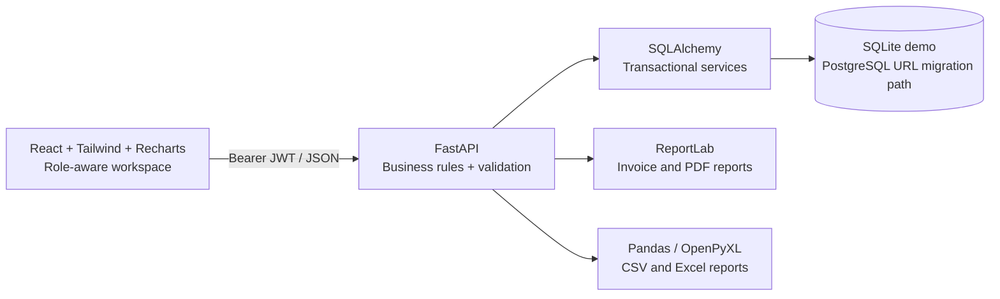
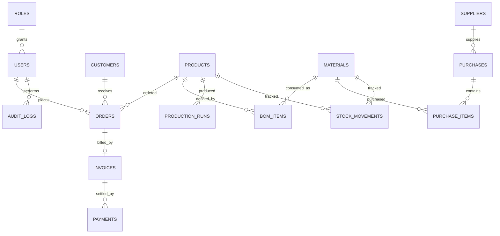

# Architecture

The FastAPI service serves the built single-page React application and `/api` from one listener. JWT authentication identifies the role; route dependencies enforce actions, while the Accountant/Auditor role can only read/export. Posted inventory changes create stock-ledger rows with source documents and audit-log entries.

## ER diagram

Tables in the initial schema: roles, users, customers, suppliers, products, materials (raw/packaging), BOM items, purchases/items, production runs, stock movements, orders, invoices, payments, expenses and audit logs. Money columns are integer paisa; quantities use fixed-precision Decimal-backed database columns. Source movement documents, unique references and foreign keys preserve traceability.
