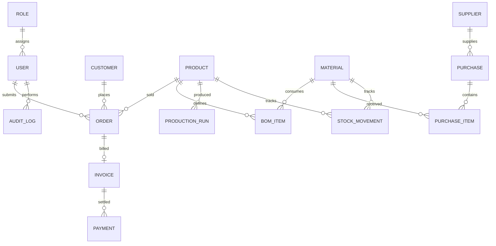

# SmartFactory design note

## BOM and production runs
The Murukku 200 g standard BOM represents one 200-packet batch: 40 kg flour, 10 L oil, 1.2 kg spice mix, 200 pouches and 10 cartons. A production run records the BOM-scaled plan beside actual issued quantities, actual good output, damaged packaging, labour, utilities and its production date. A single SQLAlchemy session/transaction records material issues, any quarantine return, finished-goods output and the run cost; exceptions roll back the transaction. The yield formula is `(actual good packets − expected packets) / expected packets × 100`. Consumption variance is `(actual issue − planned issue) / planned issue × 100`; dashboard alerts are raised when the absolute consumption variance exceeds 3%.

## Stock ledger
Opening quantities are seeded as ledger movements, not manually edited balances. Purchases, production issues/output, dispatches, returns and adjustments carry source-document references. Stock adjustments require a signed quantity plus a reason. Inventory actions reject negative balances. The benchmark's damaged 6 pouches are retained in the on-hand balance as QC-quarantined stock: therefore pouch total closing stock is 306 while available packaging is 300. This is the treatment needed to reconcile the supplied 306-pouch expected total; these damaged pieces are not treated as usable packaging. Cartons are issued at the actual 9 used. Production generates 188 good packets and finished stock becomes 238, then dispatch of 150 leaves 88.

## Costing method
Raw-material rates use weighted-average valuation on each purchase: `new average = (old quantity × old average + purchase quantity × purchase rate) / new total quantity`. For flour, `(100 × ₹42 + 60 × ₹45) / 160 = ₹43.125/kg`; material costs are computed from Decimal quantities and paisa-valued rates. Persisted money is integer paisa; tax and cost rounding use half-up where a whole-paisa result is needed. The sample batch includes actual issue value plus ₹1,200 labour and ₹600 gas/power. With 40 kg flour at ₹43.125, 10.5 L oil at ₹140, 1.2 kg spice at ₹200, 200 pouches at ₹2.50 and 9 cartons at ₹15, total cost is ₹5,870 or about ₹31.22 per good packet (₹0.01 rounding). This is production cost only, before overhead allocation, freight, discounts or tax.

## GST demonstration and known boundaries
Taxable value is quantity × pre-tax rate; GST is stored in paisa. Tamil Nadu deliveries split the 5% benchmark tax into 2.5% CGST and 2.5% SGST; other-state deliveries use 5% IGST. ₹7,500 taxable therefore yields ₹187.50 each CGST and SGST and a ₹7,875 invoice. This is an assignment demonstration, not a statutory compliance opinion. The sample HSN and GSTIN values are demo values; validate registration, HSN, applicable rates, invoice fields, e-invoicing/e-way-bill requirements, rounding, credit note process and financial-year sequences with an accountant before live use.
## Data model and relationships

The application uses SQLAlchemy models with a relational database. The main relationships are shown below.

The core master tables are users, roles, customers, suppliers, products and materials. bom_items connects products to their required materials. Purchasing is represented by purchases and purchase_items; production by production_runs; and inventory history by stock_movements. Sales orders connect customers, salesmen and products, while invoices and payments track billing and settlement. audit_logs records user actions and timestamps. Stock movements retain source-document references for traceability.

